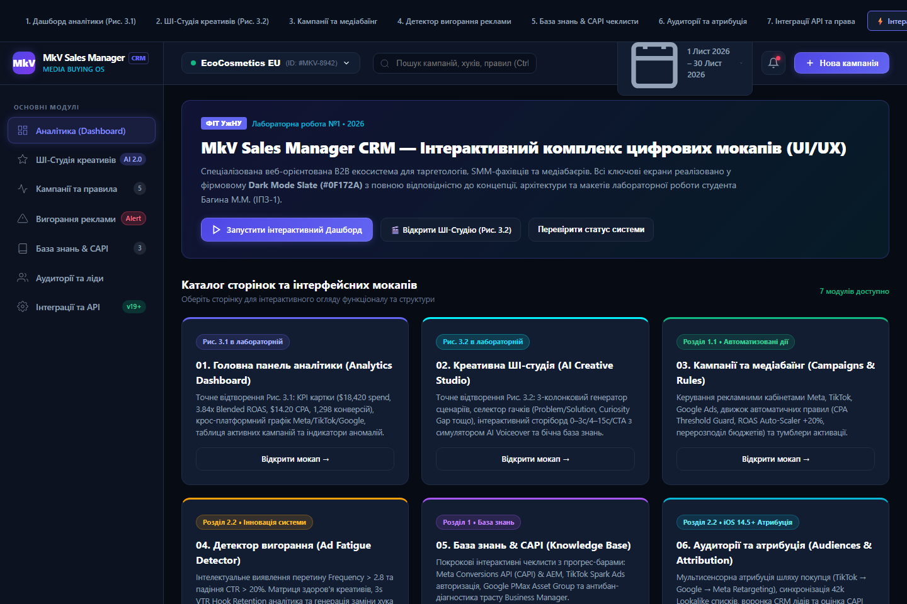
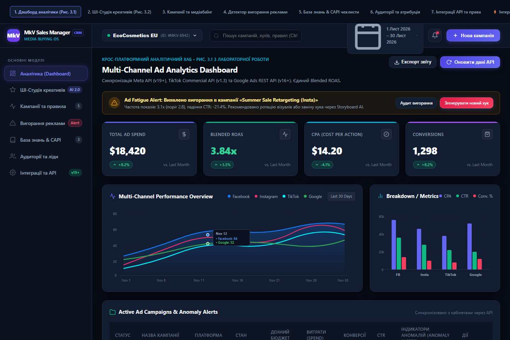
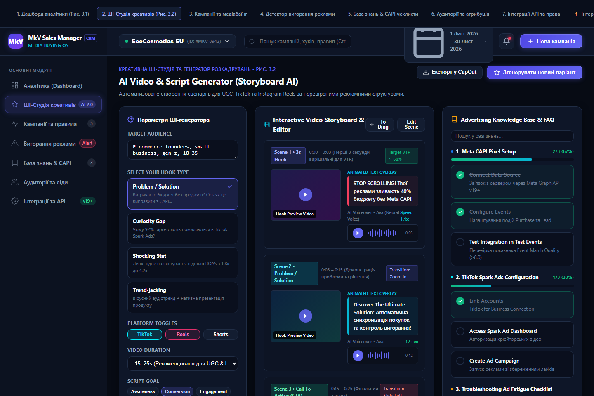
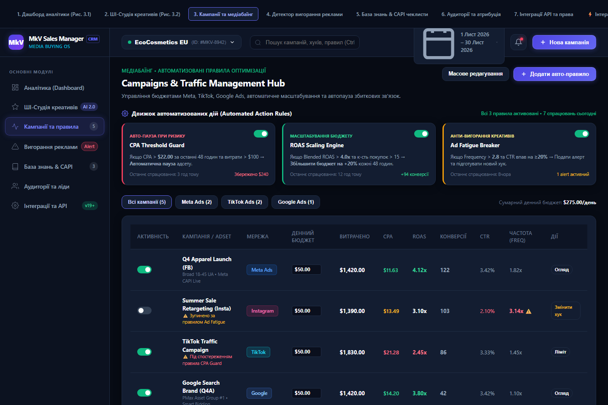
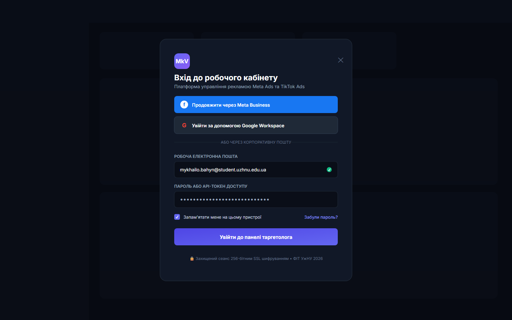

# MkV-Assistant / MkV Sales Manager CRM

> **Лабораторна робота №2 з дисципліни «Розробка веб-застосунків на базі React»**  
> **Тема:** Проєктування та представлення фінального UI/UX дизайну веб-застосунку CRM-платформи «MkV Sales Manager» для таргетологів та SMM-спеціалістів та налаштування середовища версіонування Git/GitHub

---

## 🎓 Інформація про автора та рецензента
* **Виконав:** студент 2-го курсу денної форми навчання групи ІПЗ-1 **Багин Михайло Михайлович**
* **Навчальний заклад:** ДВНЗ «Ужгородський національний університет» (УжНУ)
* **Факультет:** Факультет інформаційних технологій (ФІТ)
* **Кафедра:** Кафедра інженерії програмного забезпечення (ІПЗ)
* **Перевірив (Reviewer):** **Бучук Роман Юрійович** ([@romanbuchuk](https://github.com/romanbuchuk))

---

## 📌 Опис проєкту «MkV Sales Manager & Assistant CRM»

**MkV Sales Manager / MkV Assistant** — це спеціалізована веб-орієнтована B2B екосистема для таргетологів, SMM-менеджерів, медіабаєрів та маркетингових агенцій.

Традиційні CRM-системи (HubSpot, Bitrix24, Salesforce) зосереджені виключно на веденні бази лідів та телефонних дзвінків. Вони абсолютно не пристосовані до оперативної роботи з рекламними аукціонами, щоденного тестування маркетингових гіпотез, аналітики креативів та генерації сценаріїв для коротких відео (UGC, Reels, TikTok).

Платформа **MkV Sales Manager** об'єднує в єдиному робочому просторі:
1. **Крос-платформний аналітичний хаб:** агрегація даних Meta (Facebook, Instagram), TikTok Ads та Google Ads API, автоматичний розрахунок **Blended ROAS** в умовах обмежень Apple iOS 14.5+ ATT Framework та Safari ITP.
2. **Креативна ШІ-студія (Storyboard AI):** автоматизована генерація 3-етапних розкадрувань відеореклами (Hook 0–3с, Problem/Solution 4–15с, CTA) з анімованими титрами та синтезом озвучення AI Voiceover.
3. **Модуль Ad Fatigue Detector:** виявлення критичної точки перетину Frequency (> 2.8x) та падіння CTR (> 20%) з можливістю заміни перших 3 секунд хука в 1 клік без перенавчання адсету.
4. **Центр автоматизованих правил (Rules Engine):** авто-пауза збиткових зв'язок (CPA Guard > $22) та масштабування бюджету при високому ROAS (+20%).
5. **Інтерактивна база знань та діагностики:** покрокові регламенти налаштування Meta Conversions API (CAPI) з дедуплікацією подій, TikTok Spark Ads та Google PMax.

---

## 📁 Структура репозиторію

Репозиторій містить чисту та впорядковану структуру напрацювань:

```text
├── .github/
│   └── workflows/
│       └── ci.yml                               # GitHub Actions автоматична валідація макетів
├── 01_Головні_макети_проєкту (4 модулі + вхід)/ # Векторні SVG-макети для імпорту у Figma (6 файлів)
│   ├── 01_Головний_огляд_платформи (Рис 1.1).svg
│   ├── 02_Дашборд_аналітики (Рис 2.1).svg
│   ├── 03_ШІ_Студія_креативів (Рис 2.2).svg
│   ├── 04_Кампанії_та_медіабаїнг (Рис 2.3).svg
│   ├── 05_Детектор_вигорання_та_хуки (Рис 2.4).svg
│   └── 06_Модальне_вікно_авторизації (Рис 2.5).svg
├── ФОТО_МОКАПИ_PNG/                             # 6 фінальних растрових мокапів високої якості
│   ├── 01_Головний_огляд_платформи.png
│   ├── 02_Дашборд_аналітики.png
│   ├── 03_ШІ_Студія_креативів.png
│   ├── 04_Кампанії_та_медіабаїнг.png
│   ├── 05_Детектор_вигорання_та_хуки.png
│   └── 06_Модальне_вікно_авторизації.png
└── README.md                                    # Документація проєкту
```

---

## ⚙️ Системна архітектура та підтримувані рекламні екосистеми

| Рекламна мережа | Метод інтеграції (API) | Ключові метрики | Автоматизовані дії |
| :--- | :--- | :--- | :--- |
| **Facebook Ads (Meta)** | Meta Graph / Marketing API v19+ | Витрати, ROAS, частота (Frequency), CPM, CTR, CAPI Match Rate | Авто-пауза при високому CPA (> $22), масштабування при хорошому ROAS (+20%) |
| **Instagram Ads (Meta)** | Instagram Graph & Reels API | Перегляди Reels, утримання 3s (Hook Retention), збереження | Пошук найефективніших візуалів для повторного показу (ретаргетингу) |
| **TikTok Ads** | TikTok Commercial API v1.3 | VTR (доперегляди), ціна підписника, Spark Ad Auth | Підключення органічних відео від блогерів у Spark Ads без втрати соціальних сигналів |
| **Google Ads** | Google Ads REST API v16+ | Search Impr. Share, показники PMax, CPC, Conv. Value | Перерозподіл бюджету між ефективними ключовими словами та активами PMax |

---

## 🎨 Дизайн-система (Dark Theme Slate #0F172A)

* **Основний фон застосунку:** глибокий темний відтінок `#070B14`.
* **Контейнери та панелі:** темно-синій контейнер `#131D31` з легким бордером `rgba(255, 255, 255, 0.08)`.
* **Акцентні кнопки (Primary CTA):** індиго `#6366F1` та неоновий градієнт.
* **Статусні індикатори:** смарагдовий зелений `#10B981` (успіх/високий ROAS) та корал `#F43F5E` (перевищення CPA/вигорання).
* **Типографіка:** `Inter` (інтерфейсний текст), `Rajdhani` (великі аналітичні числа KPI), `JetBrains Mono` (ідентифікатори кампаній, токени).

---

## 🖥️ Галерея фінального UI/UX дизайну мокапів

### 1. Головний огляд платформи (Master Hub Overview)


### 2. Панель крос-платформної аналітики (Analytics Dashboard)


### 3. Креативна ШІ-студія та відео-розкадрування (AI Creative Studio)


### 4. Центр управління кампаніями та медіабаїнгом (Campaigns & Media Buying)


### 5. Детектор вигорання аудиторії та ротація хуків (Ad Fatigue Detector & Hooks)


### 6. Модуль безпечної авторизації користувача (Auth Modal)


---

## 🎯 Висновки

1. У ході виконання роботи було спроєктовано завершену компонентну UI/UX архітектуру CRM-платформи **«MkV Sales Manager»** для таргетологів та SMM-фахівців (4 основні модулі + головний хаб + модальне вікно корпоративної автентифікації).
2. Сформовано темну дизайн-систему (Slate `#0F172A`), готову до компонентної реалізації на базі **React 18 та Tailwind CSS**.
3. Репозиторій структуровано згідно з вимогами: завантажено векторні макети SVG, 6 основних растрових ілюстрацій PNG, автоматизований пайплайн CI та файл документації.
4. Налаштовано середовище версіонування Git/GitHub та підключено рецензента [@romanbuchuk](https://github.com/romanbuchuk) для перевірки напрацювань.
