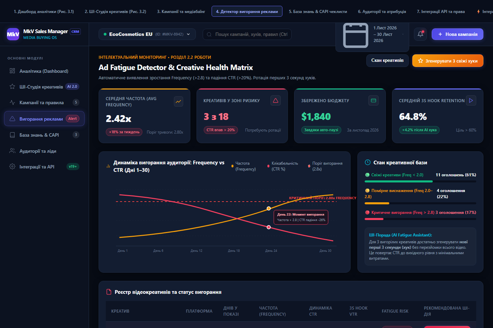

# MkV-Assistant / MkV Sales Manager CRM

> **Лабораторна робота №2 з дисципліни «Розробка веб-застосунків на базі React»**  
> **Тема:** Проєктування та представлення фінального UI/UX дизайну веб-застосунку CRM-платформи «MkV Sales Manager» для таргетологів та SMM-спеціалістів та налаштування середовища версіонування Git/GitHub

---

## 🎓 Інформація про автора та рецензента
* **Виконав:** студент 2-го курсу денної форми навчання групи ІПЗ-1 **Багин Михайло Михайлович**
* **Навчальний заклад:** ДВНЗ «Ужгородський національний університет» (УжНУ)
* **Факультет:** Факультет інформаційних технологій (ФІТ)
* **Кафедра:** Кафедра інженерії програмного забезпечення (ІПЗ)
* **Перевірив (Reviewer):** **Бучук Роман Юрійович** ([@romanbuchuk](https://github.com/romanbuchuk))
* **Звіт у форматі DOCX:** [`docs/Laboratorna_Robota_2_Bahyn_MkV_Sales_Manager.docx`](docs/Laboratorna_Robota_2_Bahyn_MkV_Sales_Manager.docx)

---

## 📌 Опис проєкту «MkV Sales Manager & Assistant CRM»

**MkV Sales Manager / MkV Assistant** — це спеціалізована веб-платформа для таргетологів, SMM-фахівців та медіабаєрів. Звичайні CRM-системи (HubSpot, Bitrix24) сфокусовані виключно на веденні клієнтської бази та фіксації дзвінків. Вони не пристосовані для ефективної закупівлі трафіку: відстеження ставок, тестування відеокреативів та захисту бюджету від перезливу.

Платформа **MkV Sales Manager** інтегрує роботу з рекламними кабінетами **Meta (Facebook, Instagram)**, **TikTok Ads** та **Google Ads** в єдиному інтерфейсі, автоматично вираховує реальну окупність (Blended ROAS), генерує покадрові сценарії для відео за допомогою ШІ та контролює вигорання аудиторії за допомогою авто-правил.

---

## ⚙️ Системна архітектура та підтримувані рекламні екосистеми

| Рекламна мережа | Метод інтеграції (API) | Ключові метрики | Автоматизовані дії |
| :--- | :--- | :--- | :--- |
| **Facebook Ads (Meta)** | Meta Graph / Marketing API | Витрати, ROAS, частота (Frequency), CPM, CTR | Авто-пауза при високому CPA (> $22), масштабування при хорошому ROAS |
| **Instagram Ads (Meta)** | Instagram Graph & Reels API | Перегляди Reels, утримання 3s, збереження | Пошук найкращих візуалів для повторного показу (ретаргетингу) |
| **TikTok Ads** | TikTok Commercial API | VTR (доперегляди), ціна підписника, Spark Ads | Підключення органічних відео від блогерів без втрати лайків |
| **Google Ads** | Google Ads REST API | Search Impr. Share, показники PMax, CPC | Перерозподіл бюджету між ефективними ключовими словами |

---

## 🛡️ Специфікація ключових модулів та автоматичних правил

1. **CPA Threshold Guard (Авто-правило захисту):** спрацьовує при CPA > $22 за останні 48 год та витратах > $100. Миттєво зупиняє збиткові оголошення.
2. **ROAS Scaling Engine (Авто-правило масштабування):** при ROAS > 4.0x та покупках > 15 за 48 год збільшує добовий бюджет зв'язки на +20%.
3. **Ad Fatigue Breaker (Контроль вигорання):** фіксує перевищення частоти показів (Frequency > 2.8) та падіння CTR > 20%, сигналізуючи про необхідність заміни початкових секунд (хука).
4. **AI Storyboard Studio (ШІ-генератор сценаріїв):** розбиває відео для TikTok/Reels на 3 сцени (хук 0–3с, проблема/засіб 4–14с, заклик до дії 15–20с) із титрами та голосовою озвучкою.
5. **Creative Push Hub:** конвертує формати (9:16 вертикаль, 1:1, 1.91:1) та пушить готові креативи в кабінети в 1 клік.
6. **CAPI Server-Side Sync:** пряма серверна передача подій для обходу блокувальників реклами та точного обліку покупок.

---

## 🎨 Дизайн-система та інтерфейс (Dark Theme)

* **Основний фон:** глибокий темний відтінок `#070B14`.
* **Картки та контейнери:** темно-синій контейнер `#131D31` з легким бордером `rgba(255, 255, 255, 0.08)`.
* **Акцентні кнопки (CTA):** індиго `#6366F1`.
* **Статусні індикатори:** смарагдовий зелений `#10B981` (успіх/високий ROAS) та корал `#F43F5E` (перевищення CPA/вигорання).
* **Типографіка:** `Inter` (інтерфейсний текст), `Rajdhani` (великі аналітичні числа KPI), `JetBrains Mono` (ідентифікатори кампаній, токени).

---

## 🖥️ Галерея фінального UI/UX дизайну

### 1. Головний огляд платформи (Master Hub)


### 2. Панель крос-платформної аналітики (Analytics Dashboard)


### 3. Креативна ШІ-студія та відео-розкадрування (AI Creative Studio)


### 4. Центр управління кампаніями та медіабаїнгом (Campaigns & Media Buying)


### 5. Детектор вигорання аудиторії та ротація хуків (Ad Fatigue Detector & Hooks)


### 6. Модуль безпечної авторизації користувача (Auth Modal)


---

## 📁 Структура репозиторію

```text
├── .github/
│   └── workflows/
│       └── ci.yml                             # Автоматична валідація структури (CI)
├── docs/
│   └── Laboratorna_Robota_2_Bahyn_MkV_Sales_Manager.docx  # Повний офіційний звіт
├── mockups/                                   # Векторні макети (SVG 1440x960 для Figma)
│   ├── 01_master_hub_overview.svg
│   ├── 02_analytics_dashboard.svg
│   ├── 03_ai_creative_studio.svg
│   ├── 04_campaigns_management.svg
│   ├── 05_ad_fatigue_detector.svg
│   ├── 06_auth_modal.svg
│   └── README.md
├── screenshots/                               # Повний набір скріншотів інтерфейсу
├── PHOTOS_PNG/                                # Додаткова галерея скріншотів
├── ФОТО_ДЛЯ_ЗВІТУ_PNG/                        # Архів ілюстрацій для звіту
├── ФОТО_ДЛЯ_ЗВІТУ_SVG/                        # Векторні SVG-ілюстрації
├── 01_analytics_dashboard.html                # Автономний інтерактивний переглядач
├── 02_ai_creative_studio.html
├── 03_campaigns_management.html
├── 04_ad_fatigue_detector.html
├── 05_auth_modal.html
├── index.html                                 # Головний хаб перегляду макетів
├── package.json                               # Конфігурація проєкту React 18 + Vite
├── .gitignore                                 # Фільтр системних файлів
└── README.md                                  # Документація проєкту
```

---

## 🛠️ Стек технологій для реалізації (React SPA)
* **Frontend:** React 18, Vite 5
* **Стилізація:** Tailwind CSS v3
* **State Management:** Zustand
* **Іконки:** Lucide React
* **Контроль версій:** Git / GitHub Flow

---

## 🚀 Налаштування Git та публікація на GitHub

```bash
# 1. Перехід у директорію проєкту
cd C:\Users\holove\Documents\Docks\MkV-Assistant

# 2. Ініціалізація Git репозиторію
git init -b main

# 3. Налаштування даних студента
git config user.name "MK043"
git config user.email "mykhailo.bahyn@student.uzhnu.edu.ua"

# 4. Створення робочої гілки для дизайну
git checkout -b feature/ui-ux-design

# 5. Підключення віддаленого репозиторію
git remote add origin https://github.com/MK043/MkV-Assistant.git

# 6. Фіксація змін
git add .
git commit -m "feat(design): complete high-fidelity UI/UX design system and mockups for MkV Sales Manager CRM"

# 7. Відправка гілок на GitHub
git push -u origin main
git push -u origin feature/ui-ux-design
```

---
*Розроблено студентом кафедри інженерії програмного забезпечення (ІПЗ) ФІТ УжНУ Багином Михайлом Михайловичем, 2026 рік.*
