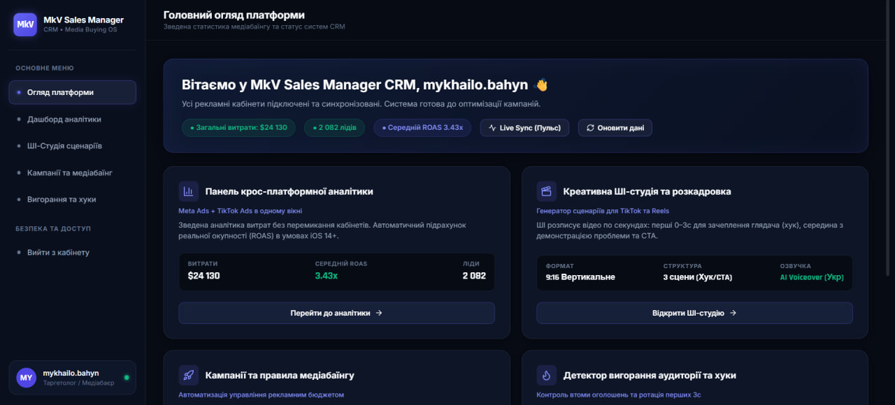
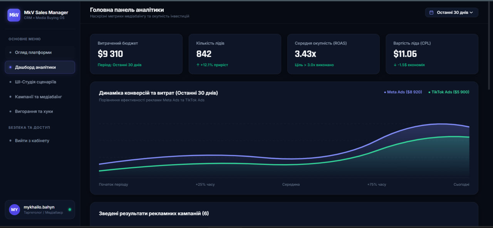
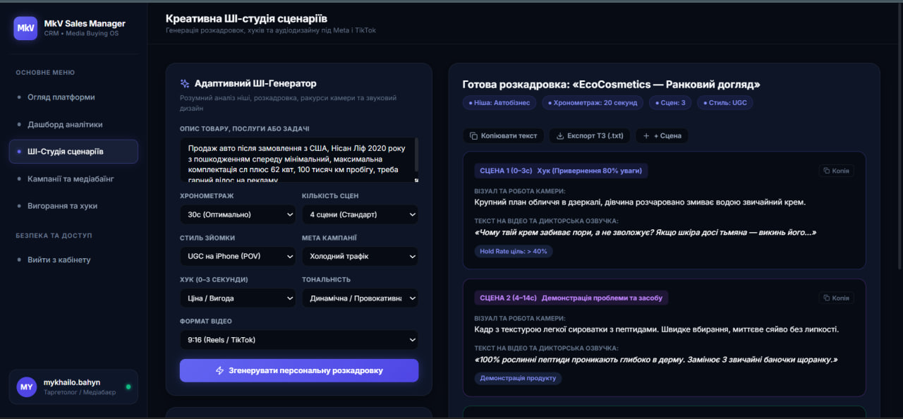
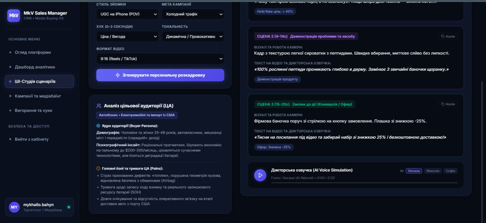
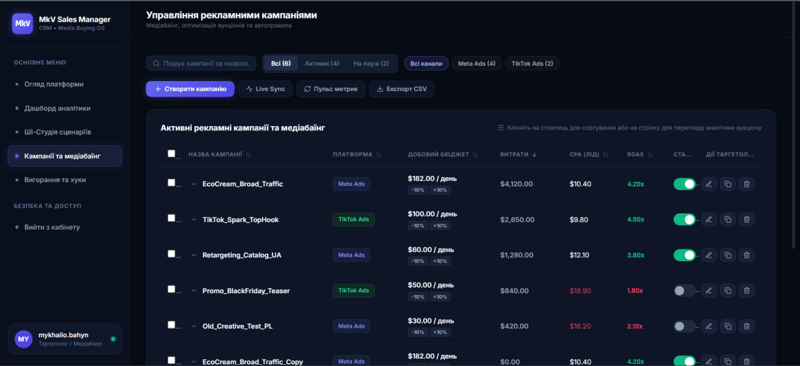
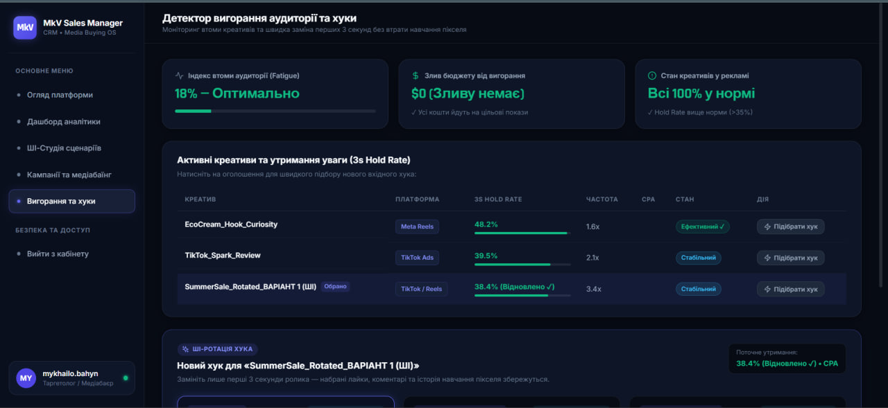

# MkV Sales Manager CRM — Медіабаїнг та ШІ-автоматизація рекламних кампаній

> **Навчальний проєкт з дисципліни «Розробка веб-застосунків на базі React»**  
> **ДВНЗ «Ужгородський національний університет» (УжНУ)**  
> Факультет інформаційних технологій | Кафедра інженерії програмного забезпечення  
> 
> * **Виконав:** студент 2-го курсу денної форми навчання групи ІПЗ-1 **Багин Михайло Михайлович**  
> * **Перевірив (Reviewer):** викладач **Бучук Роман Юрійович** ([@romanbuchuk](https://github.com/romanbuchuk))

---

## 📑 Звіти до лабораторних робіт

Усі підсумкові офіційні звіти оформлено згідно з вимогами кафедри та збережено у репозиторії:
* 📄 **[Лабораторна робота №3 — Каркас (структура) проєкту](ЗВІТИ_ДО_ЛАБОРАТОРНИХ_РОБІТ/Laboratorna_Robota_3_Bahyn_MkV_Sales_Manager.docx)** *(Архітектура React 18 + Vite, ESLint, Prettier, Husky, Cypress)*
* 📄 **[Лабораторна робота №4 — Базова верстка та компоненти](ЗВІТИ_ДО_ЛАБОРАТОРНИХ_РОБІТ/Laboratorna_Robota_4_Bahyn_MkV_Sales_Manager.docx)** *(5 робочих сторінок, модульні стилі CSS Modules, сувора відмова від сторонніх CSS-фреймворків)*
* 📄 **[Лабораторна робота №5 — Клієнтська маршрутизація](ЗВІТИ_ДО_ЛАБОРАТОРНИХ_РОБІТ/Laboratorna_Robota_5_Bahyn_MkV_Sales_Manager.docx)** *(React Router DOM v6, активні стани NavLink, екран 404, персистентний Mock API)*

---

## 🌿 Гілки проєкту та Pull Requests

Кожна лабораторна робота виконана в окремій тематичній гілці відповідно до стандарту Git Flow:
* **Лабораторна робота №3:** [`feature/lab3-project-architecture`](https://github.com/MK043/MkV-Assistant/tree/feature/lab3-project-architecture)  
  *Pull Request:* [Створити/Переглянути PR №3](https://github.com/MK043/MkV-Assistant/pull/new/feature/lab3-project-architecture)
* **Лабораторна робота №4:** [`feature/lab4-modular-css-components`](https://github.com/MK043/MkV-Assistant/tree/feature/lab4-modular-css-components)  
  *Pull Request:* [Створити/Переглянути PR №4](https://github.com/MK043/MkV-Assistant/pull/new/feature/lab4-modular-css-components)
* **Лабораторна робота №5:** [`feature/lab5-routing-navigation`](https://github.com/MK043/MkV-Assistant/tree/feature/lab5-routing-navigation)  
  *Pull Request:* [Створити/Переглянути PR №5](https://github.com/MK043/MkV-Assistant/pull/new/feature/lab5-routing-navigation)
* **Основна стабільна гілка:** [`main`](https://github.com/MK043/MkV-Assistant/tree/main)

---

## 📌 Опис платформи «MkV Sales Manager CRM»

**MkV Sales Manager** — це спеціалізована веб-орієнтована екосистема для фахівців із закупівлі трафіку (медіабаєрів, таргетологів та SMM-спеціалістів). На відміну від класичних CRM-систем (HubSpot, Salesforce), орієнтованих лише на дзвінки менеджерам, MkV Sales Manager оптимізує роботу з рекламними аукціонами Meta Ads (Facebook, Instagram) та TikTok Ads:

1. **Головний огляд платформи (`/hub`):** зведена статистика добового спенду ($24 130), лідів (2 082) та середнього ROAS (3.43x), статус систем та фонова емуляція трафіку Live Sync.
2. **Панель крос-платформної аналітики (`/analytics`):** порівняння витрат і прибутку Meta Ads ($8 920) та TikTok Ads ($5 900), фільтрація за періодами («Останні 30 днів»), згладжений графік динаміки та зведена таблиця ефективності.
3. **Креативна ШІ-студія сценаріїв (`/creative`):** адаптивний семантичний генератор розкадровок для вертикальних роликів 9:16 (Reels/TikTok) із вибором ракурсів зйомки (POV, макро, огляд), тривалості (15–60с) та хуків, доповнений **модулем аналізу ЦА (Buyer Persona, Pains)** та аудіоплеєром дикторської озвучки з вибором голосів.
4. **Центр управління кампаніями (`/campaigns`):** таблиця зв'язок із тумблерами активності (ON/OFF), швидким масштабуванням добового бюджету (-10%/+10%), фільтрами каналів та **калькулятором юніт-економіки RoasCalculator** для розрахунку виходу з фази навчання Meta/TikTok (50 конверсій за 7 днів).
5. **Детектор вигорання аудиторії та ротація хуків (`/fatigue`):** алгоритмічний моніторинг утримання перших секунд (3s Hold Rate), фіксація зливу бюджету та експрес-заміна перших 3 секунд відео без перезапуску адсету та без збивання пікселя.
6. **Модуль безпечної авторизації (`AuthModal`):** ізольоване модальне вікно з розмиттям фону (backdrop-filter) для входу через Meta Business, Google Workspace або персональний API-токен.

---

## 🖼️ Галерея актуального інтерфейсу веб-застосунку

### 1. Головний огляд платформи (Master Hub, маршрут `/hub`)


### 2. Панель крос-платформної аналітики (Analytics Dashboard, маршрут `/analytics`)


### 3. Креативна ШІ-студія сценаріїв — генератор розкадровок (маршрут `/creative`)


### 4. Модуль аналізу цільової аудиторії та аудіоплеєр дикторської озвучки (маршрут `/creative`)


### 5. Центр управління кампаніями, медіабаїнгом та калькулятор бюджету (маршрут `/campaigns`)


### 6. Детектор вигорання аудиторії та швидка ротація хуків (маршрут `/fatigue`)


---

## 🛠️ Стек технологій та інженерні рішення

* **Core:** React 18.2 (функціональні компоненти, хуки `useState`, `useEffect`, `useMemo`, `useContext`).
* **Збирач:** Vite 5 (швидкий HMR на ES-модулях, збірка Rollup).
* **Маршрутизація:** React Router DOM v6 (клієнтська маршрутизація, активні стани `<NavLink>`, редирект на `/hub`, захисний маршрут `*` зі сторінкою 404).
* **Стилізація:** **Чисті CSS Modules (`*.module.css`)** та нативні CSS Custom Properties (`src/styles/variables.css`). Повна відмова від сторонніх CSS-фреймворків (Tailwind, Bootstrap) відповідно до вимог кафедри.
* **Іконки:** Lucide React.
* **Стан та дані:** React Context API (`AppContext.jsx`) + автономний Mock API (`mockApi.js`) із персистентністю у браузерному `localStorage`.
* **Якість коду:** ESLint (правила для React 18) та Prettier (стандартизоване форматування коду).
* **Автоматизація:** Git Hooks через Husky (`.husky/pre-commit`) та `lint-staged`.
* **Тестування:** Cypress (компонентне тестування віджетів та наскрізні E2E-тести навігації).

---

## 📁 Реальна структура директорій

```text
mkv-sales-manager/
├── .github/                      # CI/CD автоматизація GitHub Actions
│   └── workflows/ci.yml          # Автоматичний запуск лінтерів та тестів
├── .husky/                       # Скрипти Git Hooks
│   └── pre-commit                # Автоматичний запуск lint-staged перед комітом
├── cypress/                      # Тестове середовище Cypress
│   ├── component/                # Компонентні юніт-тести
│   │   └── MetricCard.cy.jsx     # Ізольований тест числової KPI картки
│   └── e2e/                      # Наскрізні End-to-End інтеграційні тести
│       └── navigation.cy.js      # Перевірка маршрутизації між усіма сторінками
├── public/                       # Статичні файли проєкту
├── src/                          # Вихідний код веб-застосунку
│   ├── components/               # Багаторазові спільні UI-компоненти
│   │   ├── AuthModal/            # Модальне вікно входу (AuthModal.jsx, *.module.css)
│   │   ├── CreateCampaignModal/  # Створення нової рекламної кампанії
│   │   ├── EditCampaignModal/    # Редагування бюджету та параметрів зв’язки
│   │   ├── MetricCard/           # Уніфікована числова KPI картка (шрифт Rajdhani)
│   │   ├── Navbar/               # Верхня панель стану та дій
│   │   ├── RoasCalculator/       # Калькулятор юніт-економіки та денного бюджету
│   │   └── Sidebar/              # Бічна навігація з підсвічуванням активних розділів
│   ├── context/                  # Глобальний стан застосунку
│   │   └── AppContext.jsx        # Провайдер React Context API
│   ├── pages/                    # Сторінки-контейнери маршрутів
│   │   ├── Analytics/            # Панель аналітики витрат і графіків
│   │   ├── Campaigns/            # Управління кампаніями та медіабаїнгом
│   │   ├── CreativeStudio/       # ШІ-генератор сценаріїв та аналіз аудиторії
│   │   ├── FatigueDetector/      # Моніторинг утримання 3s Hold Rate та хуки
│   │   ├── MasterHub/            # Головний зведений хаб системи
│   │   └── NotFound/             # Захисний екран обробки неіснуючих адрес (404)
│   ├── services/                 # Бізнес-сервіси та обробка даних
│   │   ├── aiScriptEngine.js     # Семантичний генератор розкадровок за нішами
│   │   └── mockApi.js            # Автономний API-шар із персистентністю у LocalStorage
│   ├── styles/                   # Дизайн-система без зовнішніх CSS-фреймворків
│   │   ├── global.css            # Загальні стилі, нормалізація, скролбар
│   │   └── variables.css         # CSS Custom Properties темної теми Dark Slate
│   ├── App.jsx                   # Головний компонент із таблицею маршрутів
│   ├── App.module.css            # Модульні стилі головного контейнера
│   └── main.jsx                  # Точка монтування в кореневий DOM-вузол
├── ЗВІТИ_ДО_ЛАБОРАТОРНИХ_РОБІТ/  # Офіційні docx-звіти до робіт №3, №4, №5
│   ├── Laboratorna_Robota_3_Bahyn_MkV_Sales_Manager.docx
│   ├── Laboratorna_Robota_4_Bahyn_MkV_Sales_Manager.docx
│   └── Laboratorna_Robota_5_Bahyn_MkV_Sales_Manager.docx
├── .eslintrc.cjs                 # Конфігурація лінтера ESLint для React
├── .lintstagedrc.json            # Налаштування форматування лише змінених файлів
├── .prettierignore               # Виключення з форматування
├── .prettierrc                   # Конфігурація правил форматера Prettier
├── cypress.config.js             # Конфігурація тестувальника Cypress
├── package.json                  # Маніфест залежностей та скриптів проєкту
└── vite.config.js                # Конфігурація збирача Vite
```

---

## 🚀 Інструкція із запуску та перевірки

```bash
# 1. Клонування репозиторію
git clone https://github.com/MK043/MkV-Assistant.git
cd MkV-Assistant

# 2. Встановлення залежностей
npm install

# 3. Запуск локального dev-сервера (відкривається на http://localhost:3000)
npm run dev

# 4. Виробнича збірка проєкту (перевірка на відсутність помилок)
npm run build

# 5. Перевірка статичного аналізу коду (ESLint)
npm run lint

# 6. Автоматичне форматування файлів проєкту (Prettier)
npm run format

# 7. Запуск тестів Cypress
npm run test
```
